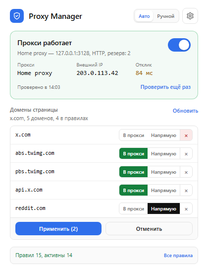
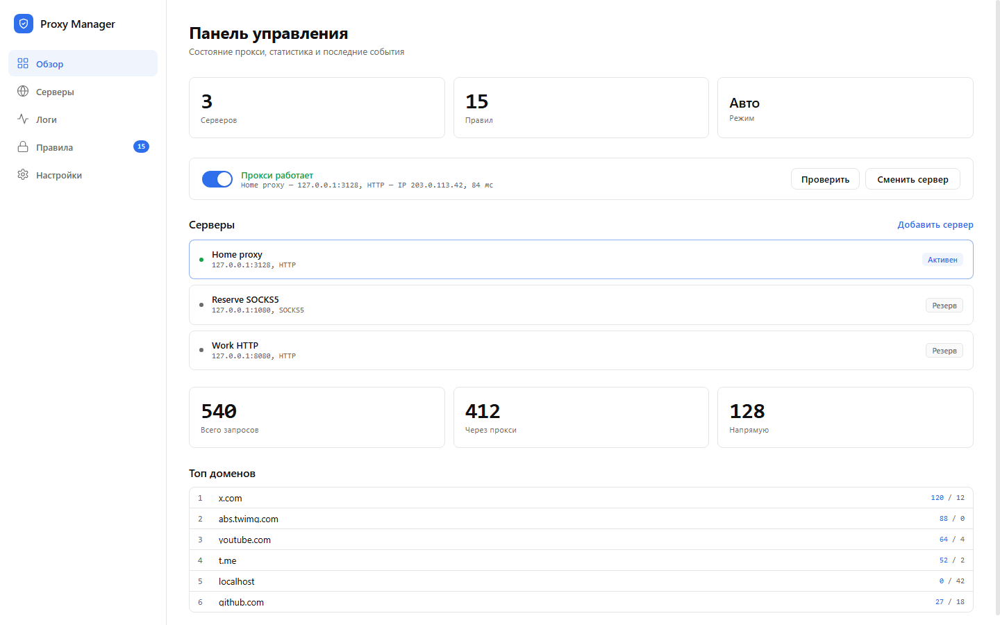
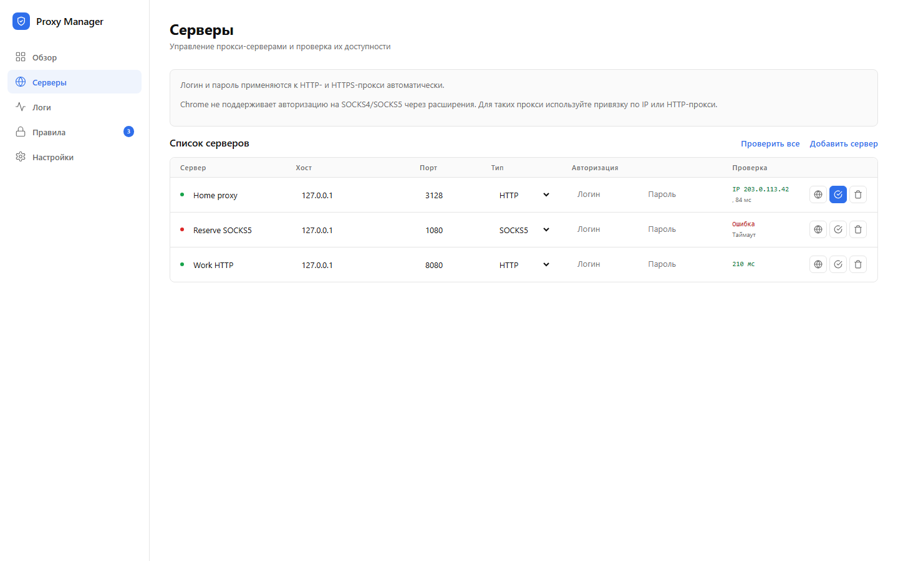
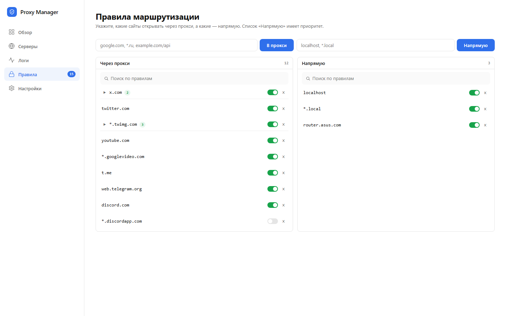
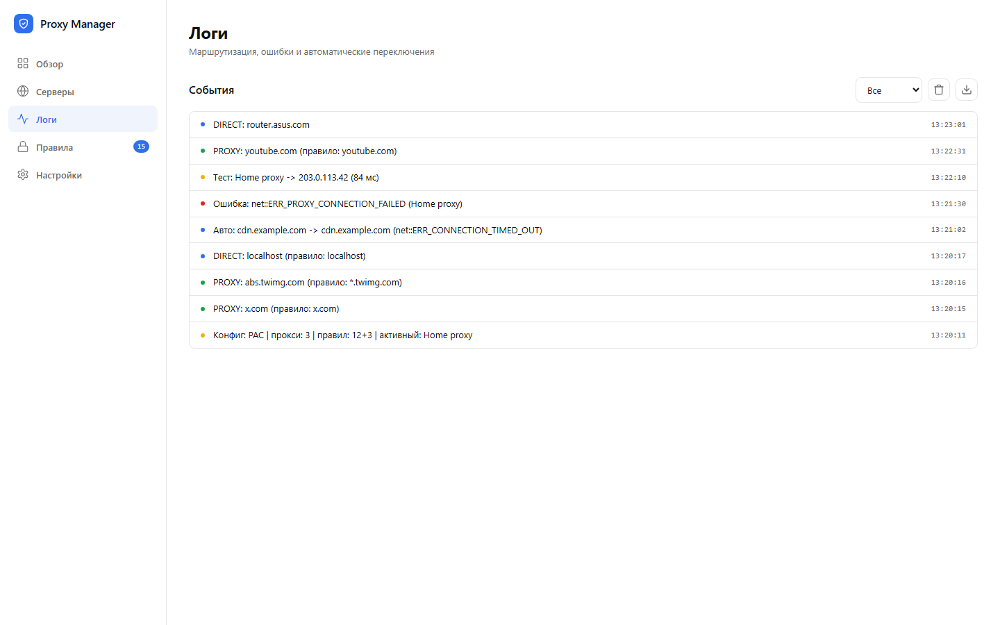
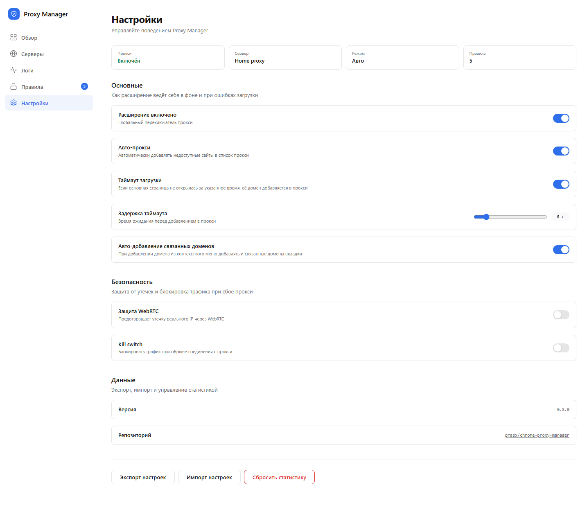
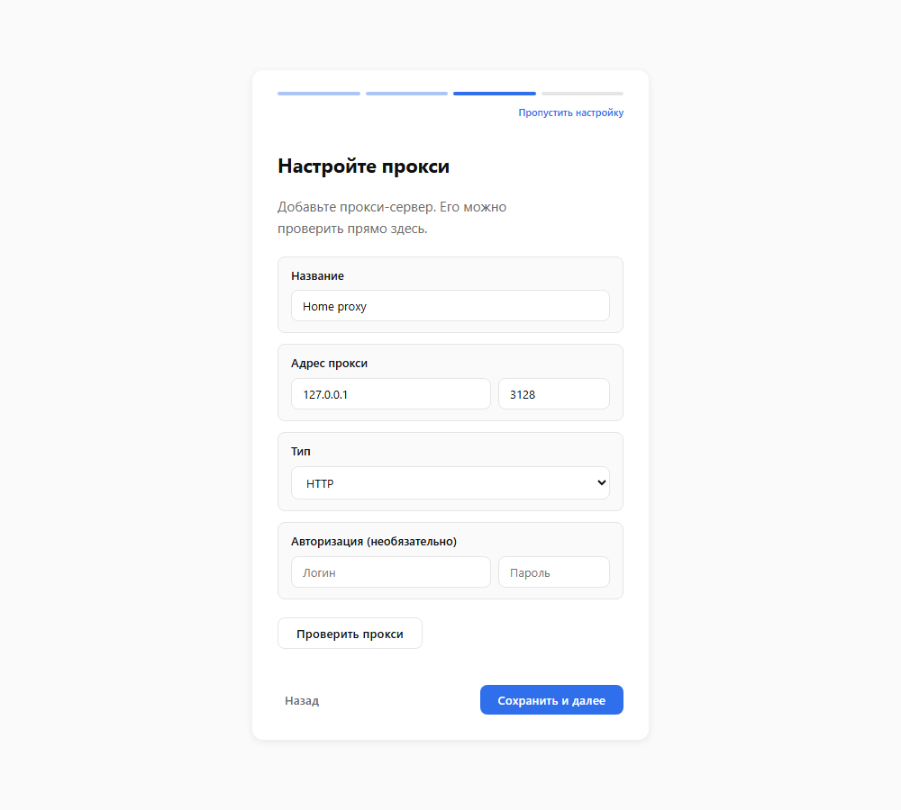

# Proxy Manager

Chrome-расширение для выборочной маршрутизации трафика через локальный прокси (SOCKS4/SOCKS5, HTTP/HTTPS) с помощью PAC-скрипта.

<p align="center">
  
</p>

<p align="center"><em>Попап: домены открытой страницы, текущий маршрут и статус активного прокси</em></p>

## Возможности

- **Домены открытой страницы** — попап сам собирает домены активной вкладки и показывает, какие из них уже в правилах. Для каждого домена можно выбрать «В прокси» или «Напрямую», применить изменения или убрать точное правило.
- **Проверка прокси** — внешний IP, задержка и понятные состояния: работает, не отвечает, прокси не выбран, выключено.
- **Режимы работы** — компактный переключатель **Авто / Ручной** в шапке попапа.
- **Два списка правил** — «Через прокси» и «Напрямую», второй имеет приоритет.
- **Несколько прокси-серверов** — активный сервер, резервная цепочка fallback и фоновая проверка здоровья. Если активный не отвечает, расширение проверяет резервы быстрым пингом и переключается на рабочий.
- **Быстрый пинг** — успешная проверка обычно занимает доли секунды, таймаут — 2 секунды на попытку; кнопка «Проверить все» прогоняет серверы по очереди, а статусы и задержка видны прямо в таблице.
- **Авторизация HTTP/HTTPS-прокси** — логин и пароль подставляются автоматически. Для SOCKS4/SOCKS5 Chrome не поддерживает авторизацию, расширение предупреждает об этом.
- **Авто-прокси** — добавление недоступных сайтов в прокси по ошибкам загрузки или таймауту.
- **Kill Switch** — блокировка трафика при обрыве соединения с прокси.
- **Защита WebRTC** — предотвращение утечки реального IP.
- **Панель управления** — обзор, серверы с проверкой IP, правила, логи и настройки.
- **Понятные ошибки** — красный «!» на иконке хранит причину: она видна в подсказке иконки, в попапе и в логах. Уведомление по клику открывает журнал.
- **Настройки** — сводка состояния, таймаут слайдером, защита WebRTC, Kill Switch, импорт/экспорт и сброс статистики.

## Скриншоты

Скриншоты демонстрационные: домены, IP и порты вымышлены.

### Обзор

<p align="center">
  
</p>

### Серверы

<p align="center">
  
</p>

### Правила

<p align="center">
  
</p>

### Логи

<p align="center">
  
</p>

### Настройки

<p align="center">
  
</p>

### Онбординг

<p align="center">
  
</p>

## Как работает маршрутизация

Для каждого запроса PAC-скрипт проверяет правила в порядке:

1. Список **«Напрямую»** (включённые записи) → `DIRECT`
2. Список **«Через прокси»** (включённые записи) → цепочка прокси
3. Иначе → `DIRECT` (или `PROXY 0.0.0.0:0` при включённом Kill Switch)

Проверка внешнего IP (`api.ipify.org`) всегда идёт строго через **активный** прокси. Поэтому попап и панель показывают состояние выбранного сервера, а не резервного.

### Цепочка fallback

Для совпадений из списка «Через прокси» браузер получает цепочку вида:

```text
SOCKS5 127.0.0.1:1080; SOCKS5 192.168.1.2:1080; DIRECT
```

- первым идёт выбранный (активный) прокси;
- затем остальные настроенные прокси с заполненными host и port;
- в конце — прямое подключение, если все прокси недоступны и Kill Switch выключен.

При ошибках прокси (`ERR_PROXY_CONNECTION_FAILED`, `ERR_TUNNEL_CONNECTION_FAILED` и подобных) расширение логирует сбой и после повторных ошибок переключает активный сервер на следующий. Тестовый режим проверки IP не меняет активный сервер и всегда восстанавливает рабочую конфигурацию.

## Режимы работы

Переключатель находится в шапке попапа, рядом с настройками:

- **Авто** — недоступные сайты автоматически добавляются в список прокси.
- **Ручной** — через прокси идут только сайты из ваших правил.

Если прокси выключен, режимы недоступны. Текущий режим сохраняется между запусками.

## Несколько серверов и переключение

- Для доменов из списка «Через прокси» PAC возвращает цепочку: активный сервер → остальные настроенные серверы → `DIRECT`. Поэтому браузер начинает использовать резерв сразу, не дожидаясь фоновой проверки.
- Раз в минуту расширение проверяет активный сервер. Если он не ответил дважды подряд, резервы проверяются быстрым 204-пингом и активным становится первый доступный.
- Если не отвечает ни один сервер, в попапе и логах появляется причина, а красный `!` остаётся на иконке.
- Статусы серверов и последняя задержка видны в таблице. Кнопка «Проверить все» проходит серверы по очереди и обновляет их статусы.

## Домены открытой страницы

При открытии попап автоматически запрашивает домены активной вкладки:

- показывает основной домен и связанные домены, которые загружает страница;
- список обновляется сам, пока попап открыт: новые домены появляются, исчезнувшие убираются;
- изменения правил извне (например, после авто-прокси) сразу отражаются в выбранных маршрутах;
- отмечает домены, уже покрытые правилами, и текущий маршрут;
- позволяет выбрать «В прокси» или «Напрямую»;
- кнопка **Применить** активна только при наличии изменений;
- крестик **×** убирает точное правило для домена;
- кнопка **Отменить** возвращает выбор к текущим правилам.

Если домен остаётся покрытым общим wildcard-правилом, после очистки появится предупреждение с названием этого правила. Такое правило нужно менять в панели управления.

## Авто-прокси

Авто-прокси работает в двух режимах:

1. **По ошибке** — при сетевых ошибках навигации или загрузки ресурсов домен добавляется в список прокси, страница перезагружается один раз с защитой от циклов.
2. **По таймауту** — если основная страница не открылась за заданное время (2–30 секунд), её домен и незавершённые ресурсы добавляются в прокси. Если страница уже загрузилась, медленные трекеры и реклама не перезагружают вкладку.

Wildcard создаётся только для явно динамических поддоменов (`cdn3.example.com` → `*.example.com`). Обычные поддомены добавляются точно (`mail.google.com`), чтобы авто-прокси не заворачивал целые сайты.

## Авторизация прокси

- **HTTP/HTTPS**: логин и пароль из настроек сервера подставляются в ответ на прокси-запрос авторизации.
- **SOCKS4/SOCKS5**: Chrome не поддерживает передачу логина и пароля для SOCKS-прокси через расширения. Используйте привязку по IP или HTTP(S)-прокси. В интерфейсе показывается соответствующее предупреждение.

Учётные данные хранятся локально в профиле Chrome и не отправляются никуда, кроме самого прокси.

## Настройки

Страница настроек показывает текущее состояние и меняет параметры без перезагрузки:

- сводка: включён ли прокси, активный сервер, режим и число правил;
- задержка авто-прокси регулируется слайдером от 2 до 30 секунд;
- защита WebRTC и Kill Switch с предупреждением, если прокси не настроен;
- экспорт и импорт конфигурации;
- сброс статистики запросов и топа доменов.

## Паттерны правил

| Паттерн | Совпадения |
|---|---|
| `google.com` | `google.com`, `mail.google.com` |
| `*.ru` | `yandex.ru`, `mail.ru` |
| `*.google.com` | поддомены `google.com` |
| `192.168.1.1` | этот IP |
| `example.com/api` | URL, содержащие `/api` на этом домене |

## Установка

Требуется **Chrome 108 или новее**.

1. Скачайте релиз или склонируйте репозиторий.
2. Откройте `chrome://extensions/`.
3. Включите **Режим разработчика**.
4. Нажмите **Загрузить распакованное** и выберите папку с расширением.
5. При первом запуске откроется мастер настройки: добавьте прокси, проверьте его и сохраните.

## Быстрый старт

1. Добавьте прокси через онбординг или панель управления.
2. Укажите домены в списках «Через прокси» и «Напрямую» либо используйте домены открытой страницы в попапе.
3. Выберите режим **Авто** или **Ручной** в шапке попапа.
4. Нажмите «Проверить» в попапе или панели, чтобы увидеть внешний IP и задержку.

## Разработка и проверки

Проект не требует сборки: это обычные JS/HTML/CSS-файлы.

```bash
npm test        # 15 unit-тестов PAC/правил + 5 интеграционных тестов service worker
npm run check   # проверка синтаксиса JS-файлов
```

## Надёжность

- Конфигурация применяется последовательно: быстрые изменения не оставляют устаревший PAC.
- Тест прокси автоматически восстанавливает настройки по таймауту, даже если service worker был выгружен.
- Логи пишутся с debounce и очищаются по будильнику, а не по таймеру, который засыпает вместе с service worker.
- Статистика записывается с throttling и не растёт бесконечно.
- Ошибки прокси отделены от сетевых ошибок сайтов, чтобы не зацикливать перезагрузки и не создавать лишние правила.

## Ограничения

- Chrome не умеет авторизоваться на SOCKS4/SOCKS5 через расширения.
- Kill Switch без настроенного прокси блокирует трафик; интерфейс предупреждает об этом.
- Очистка домена в попапе удаляет только точные правила. Если домен покрыт wildcard-правилом, его нужно менять в панели управления.

## Ссылки

- [GitHub](https://github.com/prasx/chrome-proxy-manager)
- [Сообщить об ошибке](https://github.com/prasx/chrome-proxy-manager/issues)
- [Релизы](https://github.com/prasx/chrome-proxy-manager/releases)

## Лицензия

MIT
